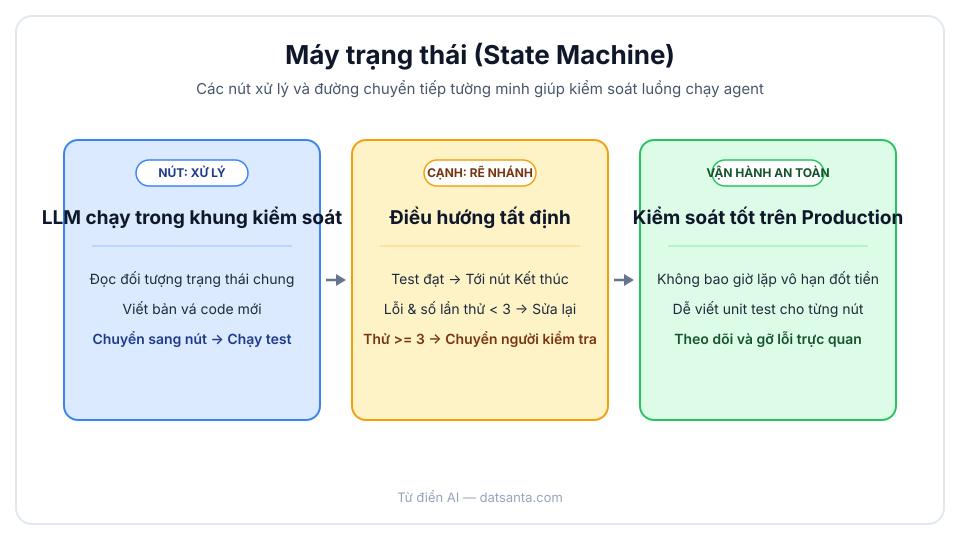

# State Machine (Máy trạng thái cho Agent)

**State machine** mô hình hóa quy trình AI thành các nút xử lý (node) và các đường chuyển tiếp (edge) rõ ràng trên một đối tượng trạng thái dùng chung—giúp lập trình viên kiểm soát chặt chẽ vòng lặp, thử lại và điểm dừng chờ người duyệt.

## Ví dụ thực tế

Ngã tư đèn giao thông không bật tắt đèn ngẫu nhiên mà đi theo thứ tự cứng (`Xanh -> Vàng -> Đỏ`) dựa trên cảm biến và đồng hồ. Vòng lặp agent tự do hoàn toàn rất dễ đi lạc hoặc đốt sạch token. Mô hình hóa agent thành máy trạng thái (vd: `Lập kế hoạch -> Thực thi -> Chạy test -> [Đạt: Xong | Lỗi: Thử lại <= 3]`) giữ được sự linh hoạt của AI bên trong từng nút mà luồng chạy vẫn cực kỳ an toàn, dễ kiểm thử.

## Đừng nhầm với

- **[ReAct Pattern](react-pattern.md):** ReAct để một LLM tự do quyết định mọi hành động kế tiếp trong vòng lặp mở; state machine giới hạn rõ bước nào được phép đi sang bước nào.

## Thuật ngữ liên quan

- [Checkpointing](checkpointing.md)
- [Orchestration](orchestration.md)
- [Circuit Breaker](circuit-breaker.md)
