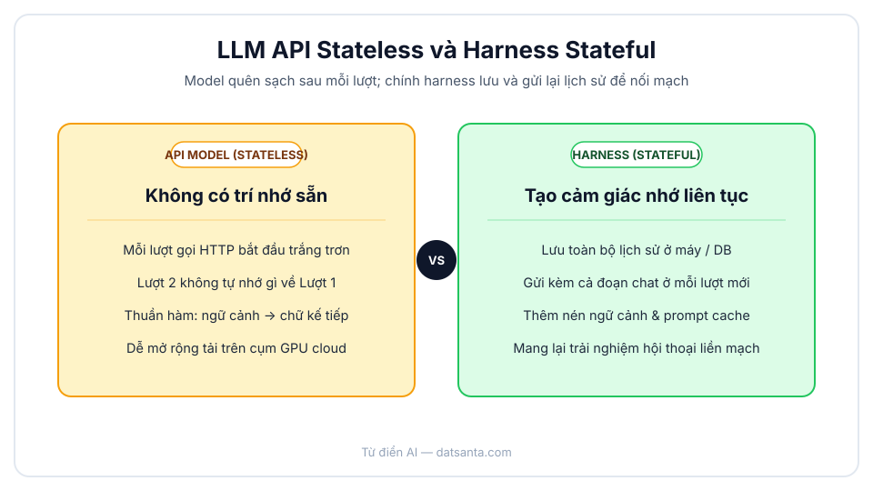

# Stateless vs. Stateful (Phi trạng thái & Có trạng thái)

API của LLM vốn **stateless** (phi trạng thái)—mỗi request bắt đầu với trí nhớ trắng trơn—nên [harness](harness.md) tạo ra cảm giác trò chuyện **stateful** (có trạng thái) bằng cách tự lưu lịch sử ở phía ứng dụng và gửi lại cả đoạn hội thoại sau mỗi lượt.

## Ví dụ thực tế

Gọi một API stateless giống như nói chuyện với chuyên gia thiên tài nhưng hễ cúp máy là quên sạch mọi thứ. Mỗi lần bạn gọi lại hỏi tiếp, thư ký của bạn (chính là harness) phải đọc lại toàn bộ biên bản những gì đã bàn trước đó để chuyên gia nắm mạch câu chuyện. Đó là lý do cuộc chat càng dài càng chậm và tốn nhiều input token hơn mỗi lượt nếu bạn không [nén ngữ cảnh](compaction.md) hoặc cache tiền tố.

## Đừng nhầm với

- **[Agent Memory](agent-memory.md):** Agent memory lưu thói quen và dữ kiện dài hạn của người dùng qua *nhiều phiên khác nhau* trong DB; stateless vs. stateful giải thích vì sao ngay trong *một phiên chat* ứng dụng vẫn phải gửi lại lịch sử cũ lên API.

## Thuật ngữ liên quan

- [Harness](harness.md)
- [Compaction](compaction.md)
- [Checkpointing](checkpointing.md)
