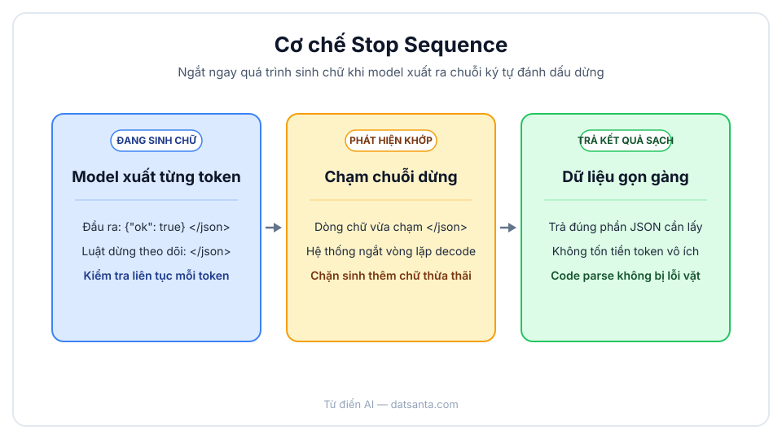

# Stop Sequence (Chuỗi dừng)

**Stop sequence** là một hoặc nhiều ký tự cụ thể (như `\nUser:` hay `</json>`) báo cho bộ chạy inference lập tức dừng sinh chữ ngay khoảnh khắc model xuất ra chuỗi đó.

## Ví dụ thực tế

Khi nói chuyện qua bộ đàm, từ "Hết" báo hiệu người nghe biết đã xong lượt nói. Nếu thiếu stop sequence trong một prompt tự thiết kế, LLM có thể trả lời xong câu hỏi của bạn rồi tự bịa thêm câu hỏi tiếp theo của người dùng và tự trả lời tiếp mãi không thôi. Đặt stop sequence chuẩn giúp tiết kiệm token đầu ra và tránh làm hỏng bộ đọc JSON.

## Đừng nhầm với

- **[Context Window](context-window.md):** Max tokens là mức trần cứng về độ dài bất kể nội dung; stop sequence dừng sinh chữ gọn gàng đúng lúc gặp ký hiệu phân tách mong muốn.

## Thuật ngữ liên quan

- [Structured Outputs](structured-outputs.md)
- [Tokenization](tokenization.md)
- [Inference](inference.md)
