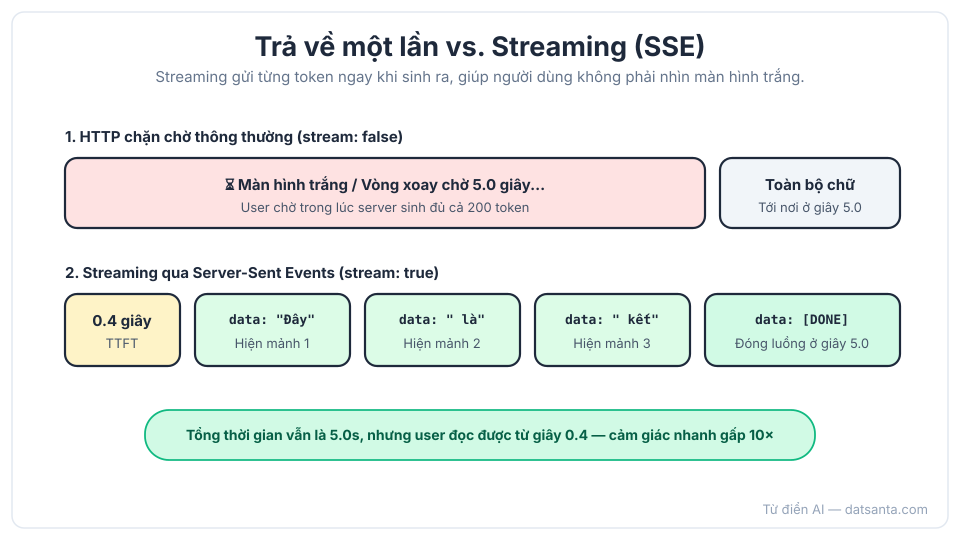

# Streaming (SSE)

**Streaming** gửi từng phần [token](token.md) đầu ra của [LLM](llm.md) về ứng dụng ngay khi vừa sinh ra (thường qua Server-Sent Events), thay vì bắt người dùng chờ đợi toàn bộ câu trả lời hoàn tất mới hiển thị.

## Ví dụ thực tế

Hãy so sánh việc tải trọn bộ phim rồi mới xem khung hình đầu tiên với việc xem trực tuyến trên Netflix. Nếu gọi HTTP chặn chờ (`stream: false`), người dùng phải nhìn vòng xoay tải suốt 5 giây đến khi sinh đủ 200 token.

Khi bật `stream: true`, chữ đầu tiên hiện ra sau ~0.4 giây (`TTFT`) và tuôn ra mượt mà từng chữ. Tổng thời gian xử lý không đổi, nhưng trải nghiệm thực tế cảm giác nhanh gấp nhiều lần.

## Đừng nhầm với

- **WebSockets:** WebSocket mở kênh hai chiều liên tục; đa số LLM API dùng Server-Sent Events (`SSE` trên HTTP) một chiều cho nhẹ vì chỉ có server đẩy token về.
- **Giảm tổng [latency](latency-vs-throughput.md):** Streaming cải thiện tốc độ *cảm nhận* (`Time To First Token`), không rút ngắn tổng thời gian tới gói `[DONE]` cuối cùng.

## Thuật ngữ liên quan

- [Latency vs. Throughput](latency-vs-throughput.md)
- [Inference](inference.md)
- [Token](token.md)
