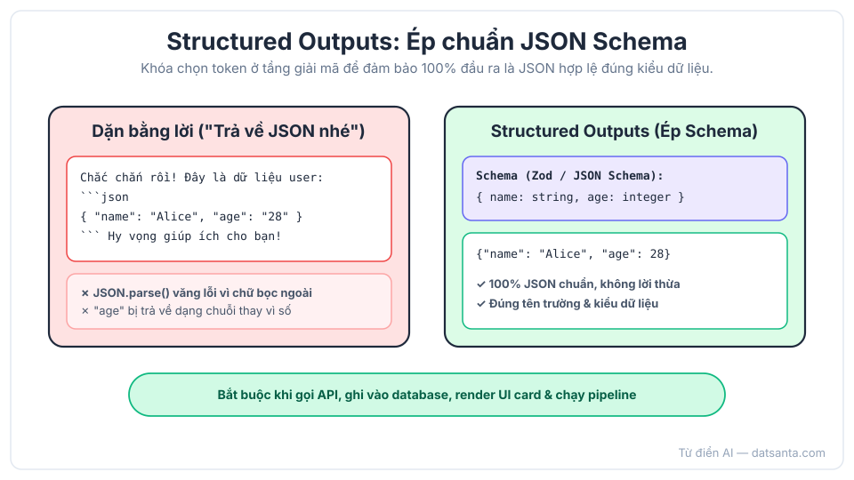

# Structured Outputs

**Structured outputs** ép [LLM](llm.md) phải trả về dữ liệu khớp đúng một lược đồ cố định (như JSON chuẩn kèm kiểu dữ liệu chặt chẽ) thay vì đoạn văn tự do khó đoán.

## Ví dụ thực tế

Việc nhắn nhủ mô hình *"Làm ơn chỉ trả về JSON"* giống như đưa tờ giấy trắng — sớm muộn nó cũng viết thêm `"Đây là JSON của bạn:"`, bọc dấu \`\`\`json hoặc trả `"28"` dạng chuỗi thay vì số nguyên, làm `JSON.parse()` văng lỗi.

Structured outputs khóa chọn token ngay ở tầng giải mã (constrained decoding): mọi token sai cú pháp đều bị chặn ở từng bước, bảo đảm 100% đầu ra là JSON hợp lệ để lưu thẳng vào database hoặc render UI.

## Đừng nhầm với

- **JSON mode (đời cũ):** Chỉ bảo đảm JSON đúng *cú pháp* dấu ngoặc, nhưng mô hình vẫn có thể bịa thiếu key hoặc sai kiểu dữ liệu; structured outputs khóa chặt cả tên trường lẫn kiểu.
- **[Function calling](function-calling.md):** Function calling dùng schema để chọn và gọi công cụ bên ngoài; structured outputs định dạng chính câu trả lời cuối cùng.

## Thuật ngữ liên quan

- [Function Calling](function-calling.md)
- [Temperature](temperature.md)
- [Few-shot Prompting](few-shot-prompting.md)
