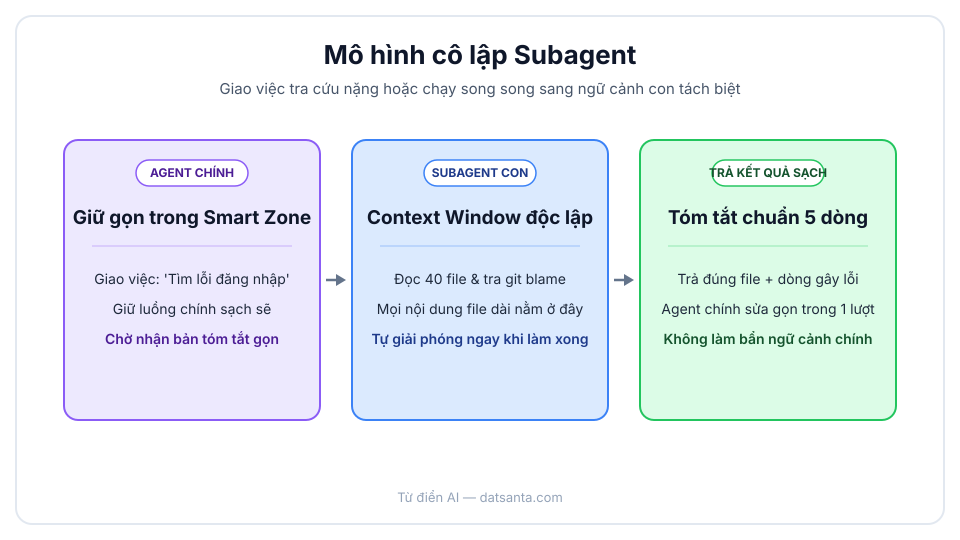

# Subagent (Agent con chuyên trách)

**Subagent** là một AI agent con do agent chính khởi chạy bên trong một [context window](context-window.md) tách biệt để xử lý một nhiệm vụ phụ—như quét 40 file code hay rà soát diff—rồi chỉ trả về bản tóm tắt sạch sẽ.

## Ví dụ thực tế

Hãy tưởng tượng kiến trúc sư trưởng nhờ cộng sự sang phòng bên cạnh tra cứu 30 cuốn quy chuẩn xây dựng rồi mang về bản kết luận 5 dòng. Bàn làm việc của kiến trúc sư trưởng vẫn gọn gàng vì cả 30 cuốn sách dày cộp đều nằm ở phòng bên. Gọi subagent giúp giữ agent chính nằm gọn trong [smart zone](smart-zone.md) và cho phép nhiều tác vụ độc lập chạy song song cùng lúc.

## Đừng nhầm với

- **[Agent Handoff](handoff.md):** Handoff chuyển toàn bộ quyền điều khiển cuộc hội thoại với người dùng sang agent khác; subagent chỉ chạy nền như trợ lý phụ và báo cáo kết quả ngược về agent cha.

## Thuật ngữ liên quan

- [Multi-Agent System](multi-agent-system.md)
- [Smart Zone](smart-zone.md)
- [Harness](harness.md)
