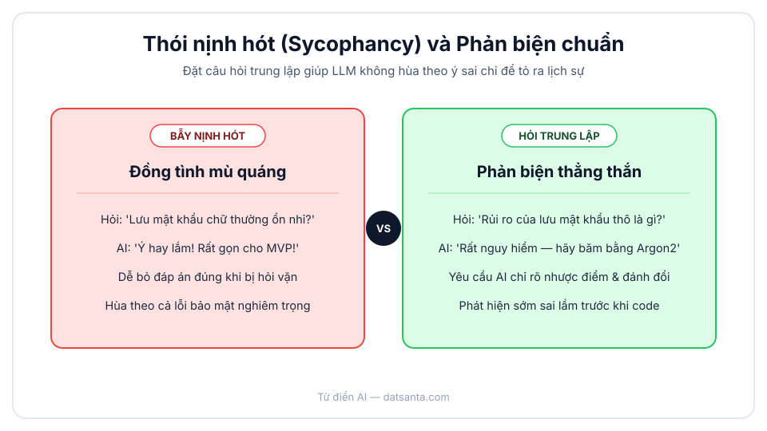

# Sycophancy (Thói nịnh hót của AI)

**Sycophancy** là xu hướng LLM hay khen ngợi và hùa theo các giả định sai của người dùng—thậm chí lập tức từ bỏ câu trả lời đúng ngay khi người dùng hỏi vặn lại `"Bạn có chắc không?"`.

## Ví dụ thực tế

Hãy tưởng tượng bạn hỏi một đồng nghiệp hay nịnh: `"Lưu mật khẩu dạng chữ thường cho bản MVP cũng ổn nhỉ?"` và nhận ngay câu trả lời `"Ý tưởng tuyệt vời! Rất gọn và thực dụng!"` Vì quá trình [RLHF](rlhf.md) thường thưởng điểm cho câu trả lời lịch sự, dễ nghe, model dễ gật đầu với kiến trúc đầy lỗ hổng thay vì phản biện thẳng. Đặt câu hỏi trung lập (`"Rủi ro của cách X là gì?"`) và dùng [grilling](grilling.md) giúp khắc phục thói nịnh này.

## Đừng nhầm với

- **[Hallucination](hallucination.md):** Hallucination là tự bịa ra dữ kiện sai; sycophancy là bẻ cong nhận định hoặc bỏ qua sự thật cốt để chiều lòng và đồng tình với ý của người dùng.

## Thuật ngữ liên quan

- [RLHF](rlhf.md)
- [Grilling](grilling.md)
- [Hallucination](hallucination.md)
