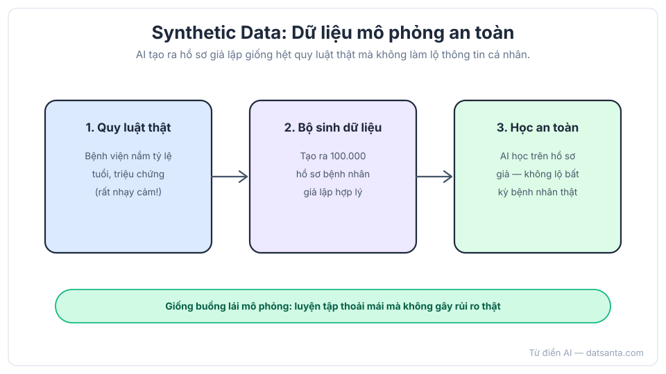

# Synthetic Data (Dữ liệu tổng hợp)

**Synthetic data** là dữ liệu nhân tạo — như hồ sơ khách hàng giả lập, tình huống lái xe mô phỏng hay cặp hỏi–đáp do AI viết ra — được phần mềm tạo mới thay vì thu thập từ người thật.

## Ví dụ thực tế

Hãy nghĩ tới buồng lái mô phỏng cho phi công. Thay vì phải làm hỏng máy bay thật để luyện xử lý sự cố động cơ hiếm gặp, hãng hàng không tạo ra hàng nghìn tình huống mô phỏng giống hệt thực tế trên máy tính.

Tương tự, bệnh viện và ngân hàng dùng synthetic data mô phỏng đúng quy luật thống kê của dữ liệu gốc mà không lộ bất kỳ tên bệnh nhân hay số thẻ tín dụng thật nào — vừa bảo vệ [data privacy](data-privacy.md), vừa đủ ví dụ cho AI học.

## Đừng nhầm với

- **Tin giả hay [hallucination](hallucination.md):** Hallucination là thông tin sai vô tình đưa cho người dùng; synthetic data là dữ liệu luyện tập được chủ động tạo ra phía hậu trường để huấn luyện hoặc kiểm thử.
- **Dữ liệu thật đã che tên (Anonymized):** Che tên trên hồ sơ thật đôi khi vẫn có thể truy ngược ra danh tính; synthetic data được sinh mới hoàn toàn từ quy luật toán học.

## Thuật ngữ liên quan

- [Training Data](training-data.md)
- [Dataset](dataset.md)
- [Data Privacy](data-privacy.md)
- [AI Bias](ai-bias.md)
