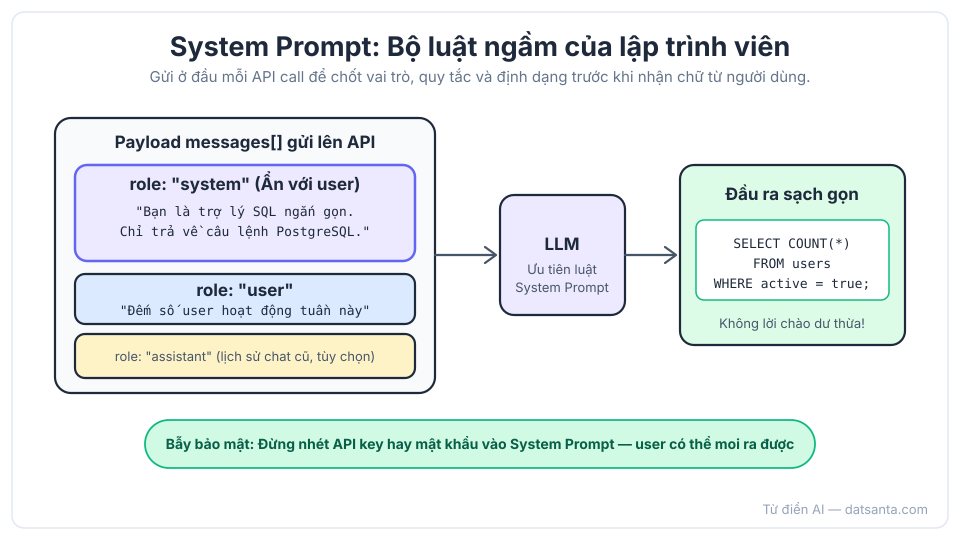

# System Prompt

**System prompt** là chỉ dẫn do lập trình viên cài sẵn ở đầu mỗi lời gọi API tới [LLM](llm.md) để khóa vai trò, giọng văn, định dạng trả về và các giới hạn bắt buộc trước khi nhận nội dung từ người dùng.

## Ví dụ đời thường

Hãy xem system prompt như cuốn sổ tay nội quy đưa riêng cho nhân viên hỗ trợ trước giờ mở cửa: *"Trả lời ngắn gọn, chỉ xuất câu lệnh PostgreSQL hợp lệ và tuyệt đối không đoán tên bảng."*

Khi user gửi câu hỏi, backend gói tin nhắn đó vào mảng `messages[]` nằm dưới phần `role: "system"`. Mô hình luôn ưu tiên tuân thủ lớp luật trên cùng này hơn là các câu trò chuyện bình thường bên dưới.

## Đừng nhầm với

- **User prompt:** Tin nhắn hiển thị do người dùng cuối tự gõ; system prompt do code ứng dụng kiểm soát và ẩn khỏi giao diện chat.
- **Két sắt bảo mật:** Tuyệt đối không giấu API key, mật khẩu hay bí mật kinh doanh trong system prompt — các chiêu [prompt injection](prompt-injection.md) vẫn có thể lừa mô hình in ngược lại nội dung đó.

## Thuật ngữ liên quan

- [Prompt](prompt.md)
- [Prompt Injection](prompt-injection.md)
- [Prompt Caching](prompt-caching.md)
- [Guardrails](guardrails.md)
