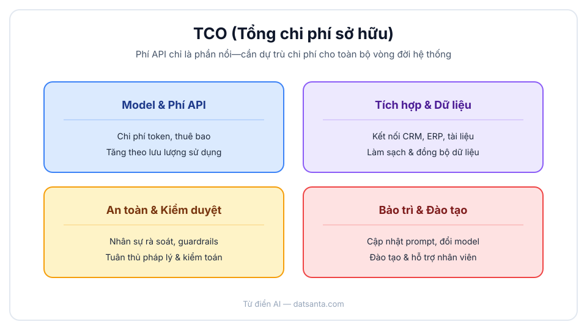

# TCO (Tổng chi phí sở hữu)

**TCO (Total Cost of Ownership)** là toàn bộ chi phí thực tế để xây dựng, vận hành và duy trì một hệ thống AI theo thời gian—không chỉ tiền mua model hay API, mà cả công tích hợp, kiểm duyệt, bảo trì và đào tạo.

## Ví dụ thực tế

Giá mua một chiếc xe giao hàng chỉ là phần nổi. Để tính đúng ngân sách, bạn phải cộng thêm tiền xăng, bảo hiểm, bảo dưỡng định kỳ, lương tài xế và chi phí sửa chữa hỏng vặt trong 3 năm. Với AI cũng vậy: phí gọi API mỗi tháng có thể rất rẻ, nhưng chi phí kỹ sư kết nối hệ thống nội bộ, nhân sự kiểm tra chất lượng đầu ra và cập nhật dữ liệu mới thường chiếm phần lớn tổng chi phí.

## Đừng nhầm với

- **[Cost per Task](cost-per-task.md):** Cost per task tính giá cho một tác vụ đơn lẻ; TCO nhìn tổng bức tranh chi phí trọn vòng đời của cả hệ thống.

## Thuật ngữ liên quan

- [AI ROI](ai-roi.md)
- [Token Budget](token-budget.md)
- [Build vs Buy](build-vs-buy.md)
