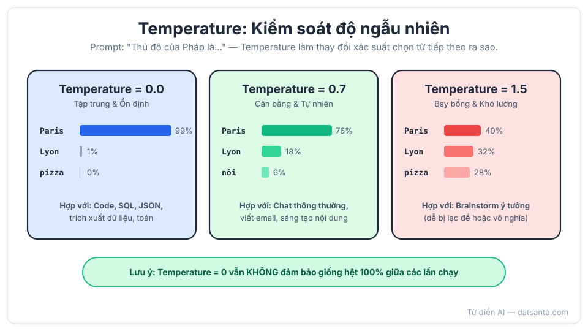

# Temperature

**Temperature** là tham số API (thường từ `0.0` đến `2.0`) điều chỉnh mức độ ngẫu nhiên hay ổn định của [LLM](llm.md) khi chọn [token](token.md) tiếp theo.

## Ví dụ thực tế

Hãy tưởng tượng một vòng quay may mắn mà ô `"Paris"` chiếm 90% diện tích và `"Lyon"` chiếm 10%. Ở `temperature = 0`, mô hình ngừng quay và luôn chọn thẳng ô lớn nhất (`"Paris"`).

Tăng lên `0.7`, thỉnh thoảng các ô nhỏ hơn vẫn trúng giúp câu văn tự nhiên và đa dạng. Kéo quá `1.2`, vòng quay san phẳng ra — những từ hiếm, kỳ quặc bắt đầu lọt vào và dễ sinh ra câu vô nghĩa.

## Đừng nhầm với

- **[Top-p sampling](top-p-sampling.md):** Temperature làm phẳng hoặc làm nhọn đường xác suất của *mọi* token; top-p cắt bỏ hẳn phần đuôi các từ quá vô lý.
- **Độ chính xác sự thật:** Đặt `temperature = 0` giúp câu trả lời ổn định giữa các lần gọi, chứ không đảm bảo đúng sự thật — mô hình vẫn có thể lặp lại y nguyên một [hallucination](hallucination.md).

## Thuật ngữ liên quan

- [Top-p Sampling](top-p-sampling.md)
- [Structured Outputs](structured-outputs.md)
- [Token](token.md)
- [Hallucination](hallucination.md)
