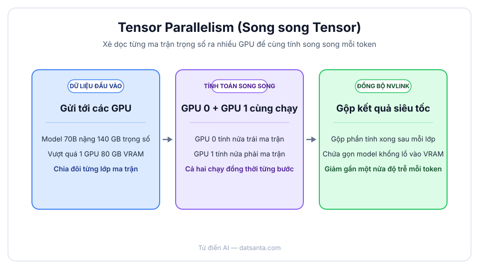

# Tensor Parallelism (Song song hóa Tensor)

**Tensor parallelism** cắt nhỏ từng ma trận trọng số bên trong mỗi lớp mạng nơ-ron ra nhiều GPU để chúng cùng tính toán song song cho từng token—cần thiết khi model quá lớn hoặc quá chậm đối với một GPU đơn lẻ.

## Ví dụ thực tế

Giả sử một model 70B cần 140 GB trọng số, trong khi mỗi GPU chỉ có 80 GB [VRAM](vram.md). Thay vì đặt lớp 1–40 lên GPU A rồi ngồi chờ GPU B chạy lớp 41–80 (pipeline parallelism), tensor parallelism xẻ đôi từng ma trận để cả hai GPU cùng tính một nửa của mỗi lớp đồng thời và đồng bộ qua NVLink siêu tốc—giảm gần một nửa độ trễ mỗi token.

## Đừng nhầm với

- **[VRAM](vram.md):** VRAM là dung lượng bộ nhớ tốc độ cao trên từng chip GPU; tensor parallelism là kỹ thuật chia tải qua nhiều GPU khi một GPU không đủ VRAM hoặc băng thông.

## Thuật ngữ liên quan

- [VRAM](vram.md)
- [Inference](inference.md)
- [vLLM](vllm.md)
