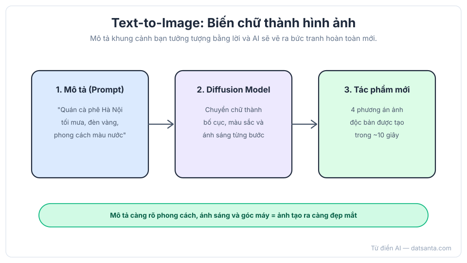

# Text-to-Image (Chuyển chữ thành ảnh)

**Text-to-image** là công cụ AI biến một đoạn mô tả bằng chữ ([prompt](prompt.md)) thành bức ảnh hoàn toàn mới — từ ảnh chụp chân thực, tranh minh họa, ý tưởng logo cho tới ảnh sản phẩm.

## Ví dụ thực tế

Hãy tưởng tượng bạn mô tả một khung cảnh cho họa sĩ siêu tốc ngồi đối diện: *"Quán cà phê gỗ ấm cúng ở Hà Nội vào một buổi tối mưa, ánh đèn vàng, phong cách màu nước."* Mười giây sau, bạn có ngay bốn bản vẽ hoàn chỉnh để chọn.

Những công cụ quen thuộc như Midjourney, DALL-E, Imagen hay Flux đều chạy [diffusion model](diffusion-model.md) bên dưới để biến lời văn thành hình ảnh chi tiết.

## Đừng nhầm với

- **Kho ảnh stock:** Tìm ảnh stock là lục lại ảnh nhiếp ảnh gia đã chụp sẵn; text-to-image tạo ra bức ảnh mới chưa từng tồn tại.
- **[Computer vision](computer-vision.md):** Computer vision nhìn ảnh để mô tả lại bằng chữ (image-to-text); text-to-image đi theo chiều ngược lại.

## Thuật ngữ liên quan

- [Diffusion Model](diffusion-model.md)
- [Generative AI](generative-ai.md)
- [Multimodal AI](multimodal-ai.md)
- [AI Watermark](ai-watermark.md)
