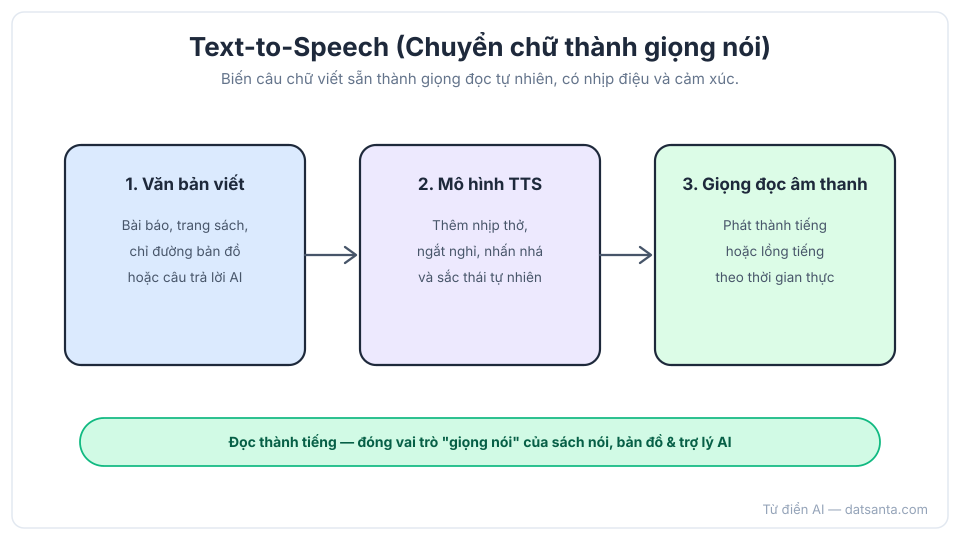

# Text-to-Speech (Chuyển chữ thành giọng nói)

**Text-to-speech (TTS)** là công nghệ AI biến văn bản viết thành âm thanh giọng nói, giúp đọc bài báo, chỉ đường trên bản đồ hoặc phát câu trả lời của [chatbot](chatbot.md) bằng giọng tự nhiên như người thật.

## Ví dụ thực tế

Text-to-speech đời cũ nghe giống hệt giọng robot đều đều: *"Rẽ. Trái. Sau. Hai. Trăm. Mét."*

Các mô hình TTS hiện đại tái tạo được cả nhịp thở, nhấn nhá, ngắt nghỉ và cảm xúc tự nhiên — giúp ứng dụng đọc sách nói, lồng tiếng video đa ngôn ngữ hoặc tạo trợ lý thoại trò chuyện mượt mà theo thời gian thực.

## Đừng nhầm với

- **[Speech-to-text](speech-to-text.md):** Text-to-speech *đọc to* chữ viết thành tiếng; speech-to-text *nghe* giọng nói rồi gõ lại thành chữ.
- **Giả giọng / [Deepfake](deepfake.md):** TTS chuẩn dùng giọng đọc phòng thu có bản quyền; sao chép giọng một người thật khi chưa xin phép sẽ rơi vào rủi ro deepfake và lừa đảo.

## Thuật ngữ liên quan

- [Speech-to-Text](speech-to-text.md)
- [Multimodal AI](multimodal-ai.md)
- [Deepfake](deepfake.md)
