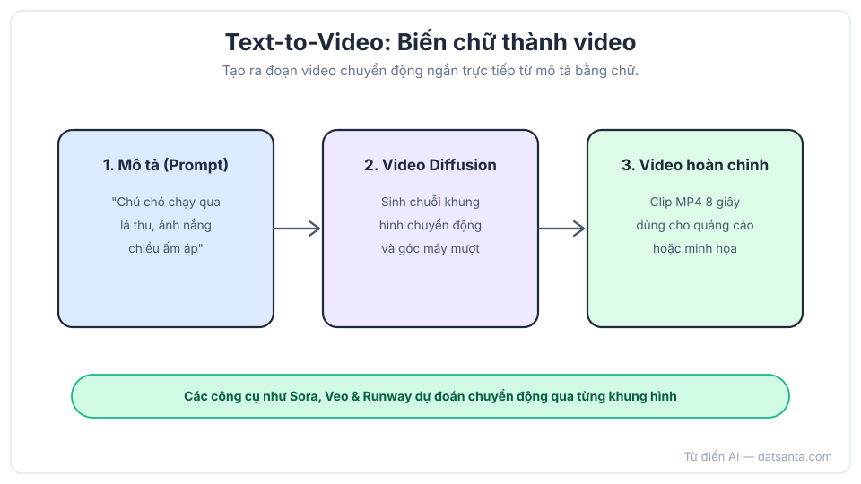

# Text-to-Video (Chuyển chữ thành video)

**Text-to-video** là công cụ AI tạo ra các đoạn video ngắn — đầy đủ cảnh chuyển động, ánh sáng và góc máy — trực tiếp từ một đoạn mô tả bằng chữ ([prompt](prompt.md)).

## Ví dụ thực tế

Hãy tưởng tượng bạn gõ *"Một chú chó golden retriever chạy chậm qua thảm lá thu dưới nắng chiều ấm áp"*, và một phút sau bạn nhận về đoạn video 8 giây sống động mà không cần cầm máy quay.

Những công cụ như Sora, Veo, Runway hay Kling dùng [diffusion model](diffusion-model.md) thế hệ mới để dự đoán chuyển động vật thể qua từng khung hình, rất hữu ích cho làm storyboard, quảng cáo và video minh họa nhanh.

## Đừng nhầm với

- **[Text-to-image](text-to-image.md):** Text-to-image tạo ra một bức ảnh tĩnh; text-to-video tạo chuỗi khung hình chuyển động theo thời gian.
- **AI chỉnh sửa video:** Tự động cắt khoảng lặng hay thêm phụ đề là chỉnh trên video quay sẵn; text-to-video tự dựng toàn bộ cảnh quay từ con số 0.

## Thuật ngữ liên quan

- [Text-to-Image](text-to-image.md)
- [Diffusion Model](diffusion-model.md)
- [Deepfake](deepfake.md)
- [AI Watermark](ai-watermark.md)
