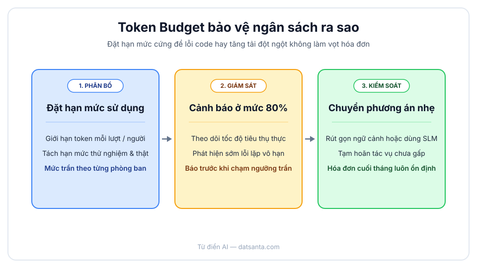

# Token Budget (Ngân sách Token)

**Token budget** là hạn mức sử dụng hoặc chi tiêu tối đa đặt ra cho một tính năng AI, một phòng ban hoặc một người dùng trong khoảng thời gian nhất định—như theo mỗi yêu cầu, mỗi ngày hoặc mỗi tháng.

## Ví dụ thực tế

Hãy hình dung thẻ đổ xăng doanh nghiệp có hạn mức 10 triệu đồng mỗi tháng cho mỗi xe tải. Tài xế vẫn chạy đúng tuyến bình thường, nhưng không một chuyến đi lạc hay sự cố nào có thể rút cạn tài khoản công ty chỉ sau một đêm. Token budget hoạt động tương tự với AI API: nó ngăn một lỗi vòng lặp code, một file tải lên quá khổ hay lượng truy cập tăng vọt biến thành hóa đơn khổng lồ bất ngờ.

## Đừng nhầm với

- **[Cost per Task](cost-per-task.md):** Cost per task đo chi phí trung bình cho một công việc; token budget là mức trần cứng để chặn việc tiêu vượt ngân sách.

## Thuật ngữ liên quan

- [Token](token.md)
- [TCO](tco.md)
- [Service Tiering](service-tiering.md)
