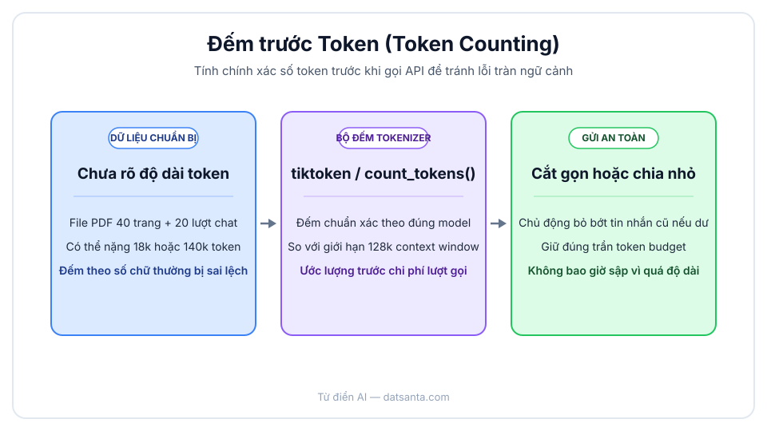

# Token Counting (Đếm trước số Token)

**Token counting** đo chính xác tổng số token của prompt, đoạn tài liệu hay lịch sử chat *trước khi* gửi API tới LLM, giúp ứng dụng không bao giờ vượt quá [context window](context-window.md) và kiểm soát chặt [ngân sách token](token-budget.md).

## Ví dụ thực tế

Nhân viên giao nhận luôn đặt kiện hàng lên cân trước khi xếp vào xe tải thay vì ước lượng bằng mắt rồi bị trả lại tại bến. Nhờ dùng bộ đếm tokenizer của đúng hãng AI (như `tiktoken` hay API `/count_tokens`), backend biết ngay file PDF 40 trang nặng `18.400` hay `140.000` token để chủ động cắt bớt lịch sử cũ thay vì gửi liều rồi nhận lỗi sập giữa chừng.

## Đừng nhầm với

- **[Tokenization](tokenization.md):** Tokenization là toàn bộ quá trình tách chữ thành mã ID để model xử lý; token counting chỉ tập trung tính tổng độ dài trước khi gọi API để cắt gọt, chia chunk và ước lượng chi phí.

## Thuật ngữ liên quan

- [Tokenization](tokenization.md)
- [Token Budget](token-budget.md)
- [Context Window](context-window.md)
