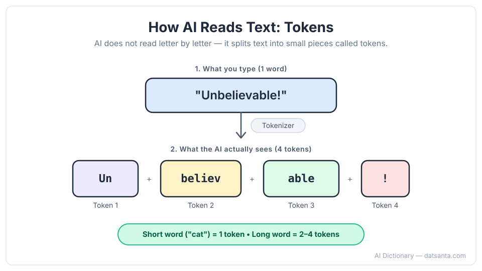

# Token

**Token** là đơn vị nhỏ nhất của văn bản mà AI đọc vào hoặc viết ra. Một token có thể là cả một từ ngắn, một phần của từ dài, hoặc chỉ là một dấu câu.

## Ví dụ đời thường

Bạn có thể hình dung token giống như những mảnh Lego ghép thành chữ. Một từ ngắn như `"cat"` là 1 mảnh Lego, còn từ dài như `"Unbelievable!"` sẽ bị tách thành 4 mảnh nhỏ: `Un` + `believ` + `able` + `!`.

Các công cụ AI đo độ dài hội thoại và tính chi phí dựa trên số lượng token — giống như đồng hồ taxi tính tiền theo cây số thay vì đếm từng bước chân. Với tiếng Anh, 100 token tương đương khoảng 75 từ; với tiếng Việt (có dấu), một từ thường tốn nhiều token hơn một chút.

## Đừng nhầm với

- **Từ (Word):** Một từ dài hoặc từ tiếng Việt có dấu có thể bị tách thành 2–4 token, không phải lúc nào cũng là 1 từ = 1 token.
- **Ký tự (Chữ cái):** Một token thường dài hơn một chữ cái, nhưng các dấu câu như `!` hay `?` vẫn có thể được tính riêng là 1 token.

## Thuật ngữ liên quan

- [LLM](llm.md)
- [Context window](context-window.md)
- [Prompt](prompt.md)
