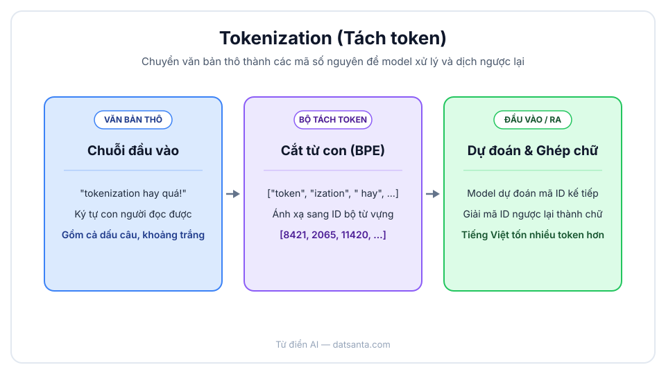

# Tokenization (Tách token)

**Tokenization** là bước cắt văn bản thô thành các mã số nguyên nhỏ (gọi là token) để model đọc được, và ghép các mã token đầu ra ngược lại thành chữ dễ đọc.

## Ví dụ thực tế

Hãy hình dung máy in hóa đơn nhà bếp biến câu gọi món dài của phục vụ ("cà phê sữa yến mạch ít đá") thành các mã viết tắt gọn nhẹ (`CF-OAT-ITDA`) để máy pha chế xử lý thật nhanh. Các LLM hiện đại dùng bộ tách từ con như BPE: từ tiếng Anh phổ biến thường giữ nguyên (`"hello"` = 1 token), còn từ hiếm hoặc tiếng Việt có dấu thường tách thành nhiều mảnh nhỏ hơn.

## Đừng nhầm với

- **[Embeddings](embeddings.md):** Tokenization chỉ gán mã ID tra cứu cho từng mảnh chữ; embeddings biến các mã ID đó thành vector mang ý nghĩa ngữ nghĩa bên trong mạng nơ-ron.

## Thuật ngữ liên quan

- [Token](token.md)
- [Token Counting](token-counting.md)
- [Context Window](context-window.md)
