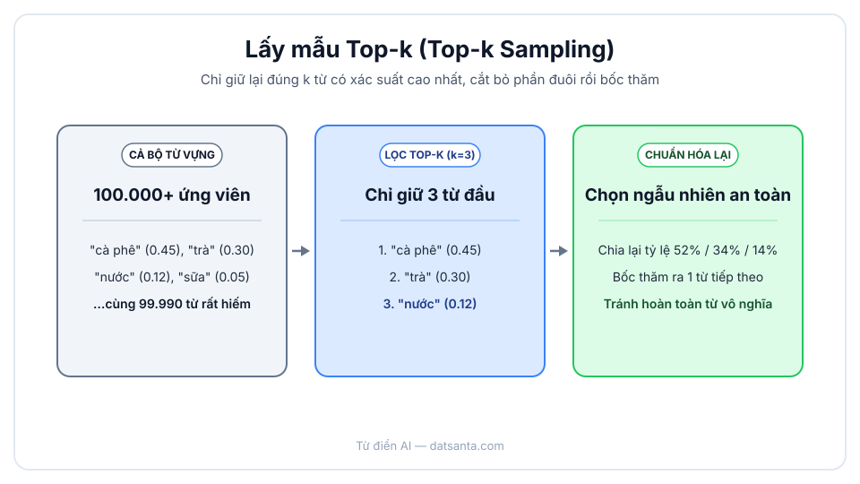

# Top-k Sampling (Lấy mẫu Top-k)

**Top-k sampling** là quy tắc giải mã giới hạn model chỉ được chọn token tiếp theo trong số `k` ứng viên có xác suất cao nhất, cắt bỏ phần đuôi gồm những từ vô lý hoặc quá hiếm.

## Ví dụ thực tế

Hãy tưởng tượng bạn tung xúc xắc chọn quán ăn trưa giữa 5.000 nhà hàng trong thành phố. Khi đặt `top-k = 5`, bạn chỉ bỏ tên 5 quán được đánh giá cao nhất vào mũ để bốc thăm, tránh hoàn toàn rủi ro bốc nhầm quán kém chất lượng. Đặt `k = 1` đồng nghĩa luôn chọn đúng phương án cao điểm nhất, còn `k = 50` giữ được sự đa dạng tự nhiên mà vẫn an toàn.

## Đừng nhầm với

- **[Top-p Sampling](top-p-sampling.md):** Top-k luôn giữ cố định đúng `k` lựa chọn; top-p giữ số lượng lựa chọn linh hoạt sao cho tổng xác suất tích lũy đạt ngưỡng đặt trước (ví dụ 90%).

## Thuật ngữ liên quan

- [Top-p Sampling](top-p-sampling.md)
- [Temperature](temperature.md)
- [Softmax](softmax.md)
