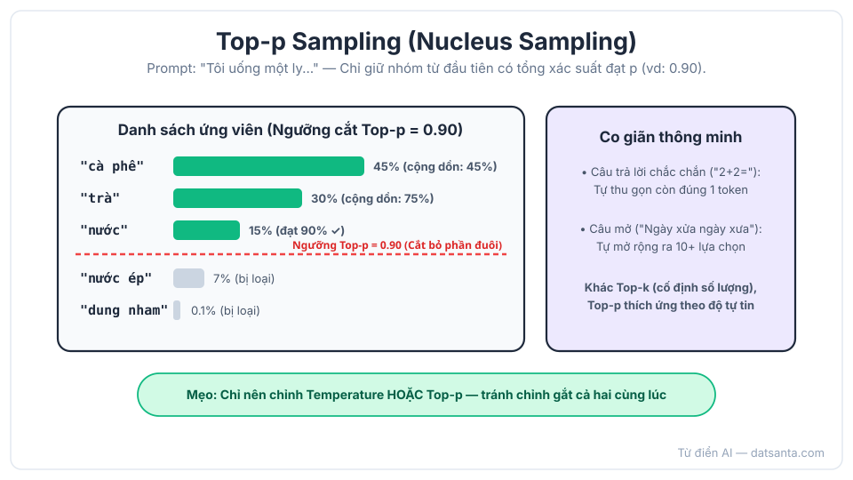

# Top-p Sampling

**Top-p sampling** (lấy mẫu hạt nhân) chọn [token](token.md) tiếp theo từ nhóm ít ứng viên nhất có tổng xác suất cộng lại chạm ngưỡng `p` (ví dụ `0.90`), loại bỏ hoàn toàn phần đuôi các từ vô lý.

## Ví dụ thực tế

Giả sử bạn gõ *"Tôi uống một ly..."* và mô hình xếp hạng `"cà phê"` (45%), `"trà"` (30%), `"nước"` (15%), `"nước ép"` (7%) cùng hàng nghìn từ lạ như `"dung nham"` (0.01%).

Với `top_p = 0.90`, mô hình cộng `45% + 30% + 15% = 90%` rồi dừng ngay tại đó. Chỉ 3 lựa chọn hợp lý đầu tiên được bốc thăm; `"dung nham"` bị loại thẳng. Nếu mô hình chắc chắn 99% một đáp án, rổ ứng viên tự thu về đúng 1 từ.

## Đừng nhầm với

- **Top-k sampling:** Top-k luôn giữ số lượng cố định (ví dụ 50 từ), kể cả khi chỉ có 2 từ hợp nghĩa; top-p co giãn linh hoạt theo độ tự tin của mô hình.
- **[Temperature](temperature.md):** Temperature chỉnh độ dốc xác suất; các hãng API thường khuyên chỉ chỉnh Temperature *hoặc* Top-p, tránh chỉnh gắt cả hai cùng lúc.

## Thuật ngữ liên quan

- [Temperature](temperature.md)
- [Token](token.md)
- [Inference](inference.md)
