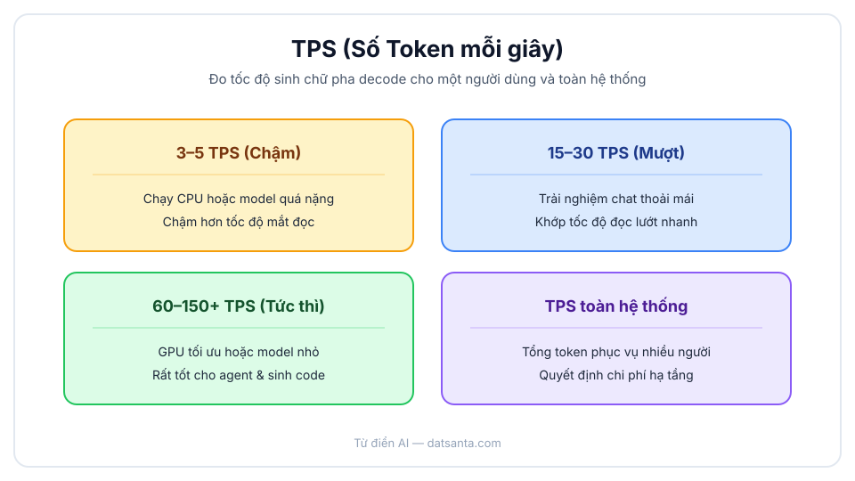

# TPS (Số Token mỗi giây)

**TPS (Tokens per Second)** đo tốc độ LLM sinh ra các token đầu ra trong pha decode—quyết định dòng chữ chạy ra nhanh hơn tốc độ đọc của người hay nhỏ giọt từng từ một.

## Ví dụ thực tế

Khi người bạn bắt đầu trả lời câu hỏi, TPS chính là tốc độ nói của họ tính theo số từ mỗi giây. Con người đọc thoải mái ở mức khoảng 5–10 token/giây, nên API đạt 60+ TPS cho cảm giác mượt mà tức thì, còn model chạy local trên CPU ở mức 3 TPS sẽ thấy rõ sự ì ạch. Với hệ thống xử lý hàng loạt, tổng TPS cao trên nhiều người dùng giúp giảm mạnh chi phí máy chủ.

## Đừng nhầm với

- **[TTFT (Time to First Token)](ttft.md):** TTFT là thời gian chờ trước khi token đầu tiên xuất hiện; TPS là tốc độ dòng chữ chạy ra liên tục ngay sau đó.

## Thuật ngữ liên quan

- [TTFT](ttft.md)
- [Latency vs. Throughput](latency-vs-throughput.md)
- [Inference](inference.md)
