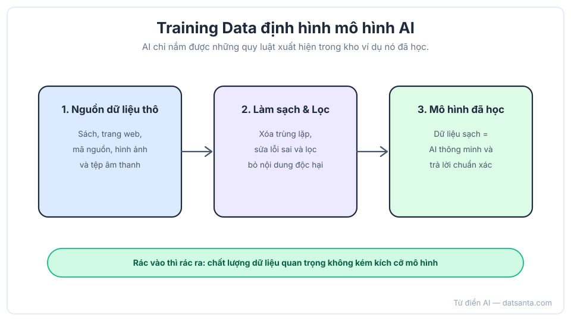

# Training Data (Dữ liệu huấn luyện)

**Training data** là kho ví dụ khổng lồ — gồm sách báo, trang web, hình ảnh, code hoặc tệp âm thanh — mà AI đọc và học trong quá trình huấn luyện để hình thành kiến thức và kỹ năng.

## Ví dụ thực tế

Nếu bạn chỉ học nấu ăn từ sách ẩm thực Ý, bạn sẽ nấu mì pasta cực ngon — nhưng sẽ lúng túng khi có người nhờ nấu phở.

AI cũng bị định hình y hệt bởi training data của nó. Dữ liệu sạch và đa dạng tạo ra mô hình thông minh, hữu ích. Ngược lại, dữ liệu lỗi thời, cẩu thả hoặc thiên lệch sẽ trực tiếp tạo ra sai sót và [AI bias](ai-bias.md) ("rác vào thì rác ra").

## Đừng nhầm với

- **[Prompt](prompt.md):** Prompt là thứ bạn gõ vào lúc trò chuyện; training data là toàn bộ tài liệu AI đã học từ nhiều tháng trước khi ra mắt.
- **[Dataset](dataset.md):** Dataset là bất kỳ tập dữ liệu có tổ chức nào (để học, kiểm tra hoặc phân tích); training data là phần riêng dùng để dạy mô hình.

## Thuật ngữ liên quan

- [Dataset](dataset.md)
- [Machine Learning](machine-learning.md)
- [AI Bias](ai-bias.md)
- [Knowledge Cutoff](knowledge-cutoff.md)
