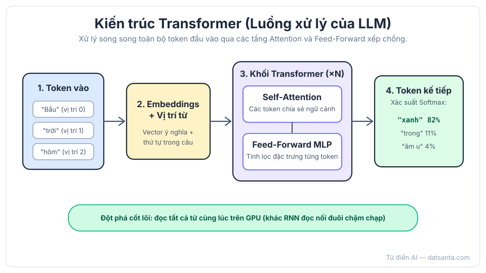

# Transformer

**Transformer** là kiến trúc mạng nơ-ron đứng sau các [LLM](llm.md) hiện đại. Đột phá của nó là đọc toàn bộ [token](token.md) đầu vào song song cùng lúc và dùng các tầng [attention](attention-mechanism.md) để nắm mối liên hệ trên cả đoạn văn bản.

## Ví dụ đời thường

Các mô hình đời cũ (RNN) đọc chữ giống như người nhìn qua lỗ khóa, trượt từng từ một trên trang giấy — vừa chậm vừa dễ quên mất đầu câu nếu đoạn văn dài.

Transformer trải phẳng cả trang giấy lên bàn dưới ánh đèn sáng. Mọi từ kết nối trực tiếp với mọi từ khác đồng thời qua các khối attention và feed-forward xếp chồng, giúp GPU huấn luyện song song trên lượng dữ liệu khổng lồ.

## Đừng nhầm với

- **RNN / LSTM:** Kiến trúc cũ đọc tuần tự từng chữ một và hụt hơi với ngữ cảnh dài; Transformer đã thay thế chúng trong bài toán ngôn ngữ.
- **[LLM](llm.md):** LLM là sản phẩm đã được huấn luyện (trọng số + dữ liệu); Transformer là bản thiết kế kiến trúc bên dưới dùng để xây nên nó.

## Thuật ngữ liên quan

- [Attention Mechanism](attention-mechanism.md)
- [LLM](llm.md)
- [Embeddings](embeddings.md)
- [Inference](inference.md)
