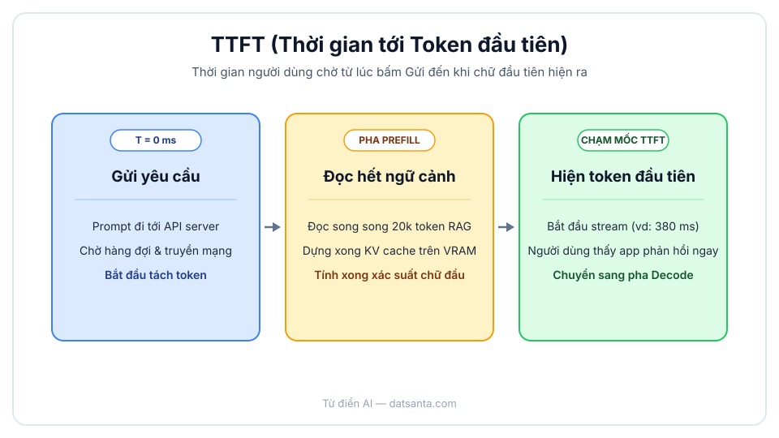

# TTFT (Thời gian tới Token đầu tiên)

**TTFT (Time to First Token)** là khoảng thời gian người dùng phải chờ sau khi gửi prompt cho đến khi token đầu tiên của câu trả lời xuất hiện trên màn hình.

## Ví dụ thực tế

Khi gọi điện đặt đồ ăn, TTFT là số giây chờ chuông reo cho tới lúc nhân viên nhấc máy nói "Alo"—dù việc đọc lại toàn bộ đơn hàng sau đó mất thêm 20 giây nữa. Trong ứng dụng chat có [streaming](streaming.md), TTFT thấp (dưới 500 ms) tạo cảm giác phản hồi tức thì, còn TTFT 6 giây do nhồi quá nhiều tài liệu RAG khiến người dùng tưởng app bị treo.

## Đừng nhầm với

- **[TPS (Tokens per Second)](tps.md):** TTFT đo độ trễ khởi động trước khi chữ đầu tiên xuất hiện; TPS đo tốc độ chữ chạy ra đều đặn sau đó.

## Thuật ngữ liên quan

- [Prefill and Decode](prefill-and-decode.md)
- [Streaming (SSE)](streaming.md)
- [Latency vs. Throughput](latency-vs-throughput.md)
