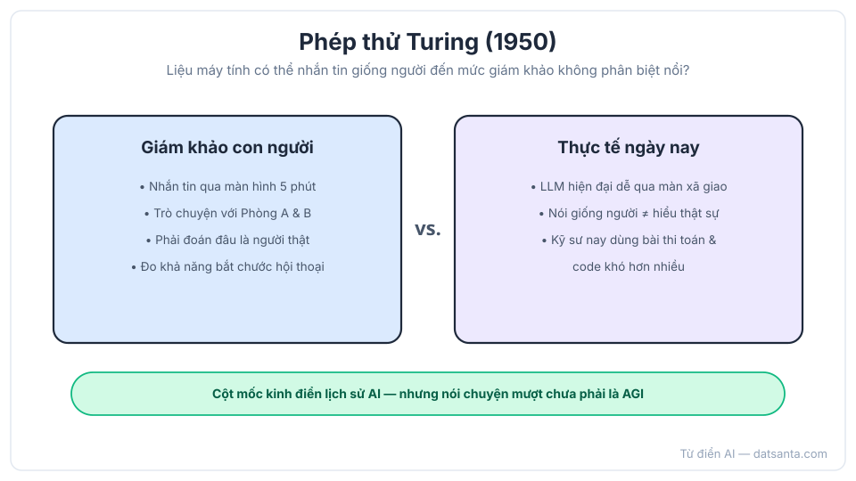

# Turing Test (Phép thử Turing)

**Turing Test**, do nhà khoa học máy tính Alan Turing đề xuất năm 1950, kiểm tra xem một cỗ máy có thể trò chuyện bằng văn bản thuyết phục đến mức giám khảo con người không phân biệt nổi đâu là máy và đâu là người thật hay không.

## Ví dụ thực tế

Hãy tưởng tượng bạn nhắn tin qua màn hình với hai người ẩn danh ở hai phòng riêng — một là người bạn thật, một là [chatbot](chatbot.md) AI. Sau năm phút trò chuyện tự do, nếu bạn đoán nhầm nhiều hơn đoán đúng, AI đã vượt qua phép thử.

Các [LLM](llm.md) ngày nay nói chuyện tự nhiên đến mức dễ dàng vượt qua kiểu trò chuyện xã giao này — nhưng nói giống người vẫn chưa đồng nghĩa với hiểu thật sự hay đạt tới [AGI](agi.md).

## Đừng nhầm với

- **Thước đo đạt tới [AGI](agi.md):** Vượt qua phép thử bắt chước trò chuyện chỉ chứng minh khả năng giả lập ngôn ngữ tốt, không chứng minh AI làm chủ mọi công việc thực tế.
- **[Benchmark](benchmark.md) hiện đại:** Kỹ sư ngày nay dùng các bài thi đo toán, lập trình và độ chính xác thực tế thay vì chỉ đo xem AI có đánh lừa được người trò chuyện hay không.

## Thuật ngữ liên quan

- [AI](ai.md)
- [Chatbot](chatbot.md)
- [AGI](agi.md)
- [Benchmark](benchmark.md)
