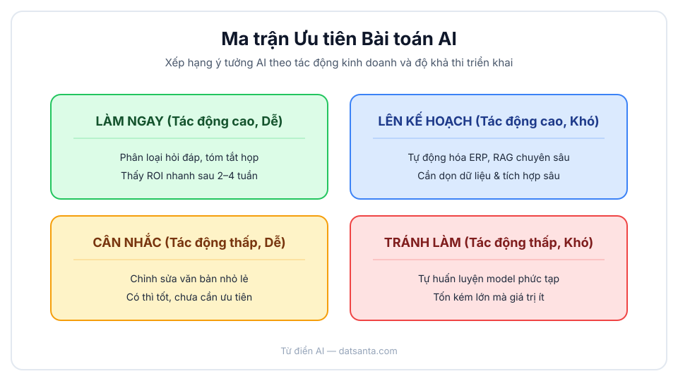

# Use Case Prioritization (Ưu tiên bài toán AI)

**Use case prioritization** là cách xếp hạng các ý tưởng ứng dụng AI dựa trên giá trị mang lại và độ khó triển khai, giúp doanh nghiệp chọn đúng 1–2 bài toán "dễ thắng, hiệu quả cao" để làm trước thay vì dàn trải.

## Ví dụ thực tế

Khi dọn một căn phòng bừa bộn trong 30 phút, bạn sẽ nhặt rác lớn và gấp chăn màn trước để thấy phòng gọn hẳn, chứ không ngồi phân loại từng chiếc kẹp giấy. Khi chọn bài toán AI cũng vậy: lập bảng chấm điểm giữa "tác động kinh doanh" (tiết kiệm bao nhiêu giờ, tăng bao nhiêu doanh thu) và "độ khả thi" (dữ liệu có sẵn chưa, rủi ro sai sót thấp không) sẽ giúp bạn nhìn ra ngay dự án nên khởi động đầu tiên.

## Đừng nhầm với

- **[AI Strategy](ai-strategy.md):** AI strategy đặt mục tiêu tổng thể cho cả năm; use case prioritization là bước sàng lọc cụ thể để chọn việc nào làm trong quý này.

## Thuật ngữ liên quan

- [Bottleneck Analysis](bottleneck-analysis.md)
- [AI ROI](ai-roi.md)
- [AI Pilot](ai-pilot.md)
