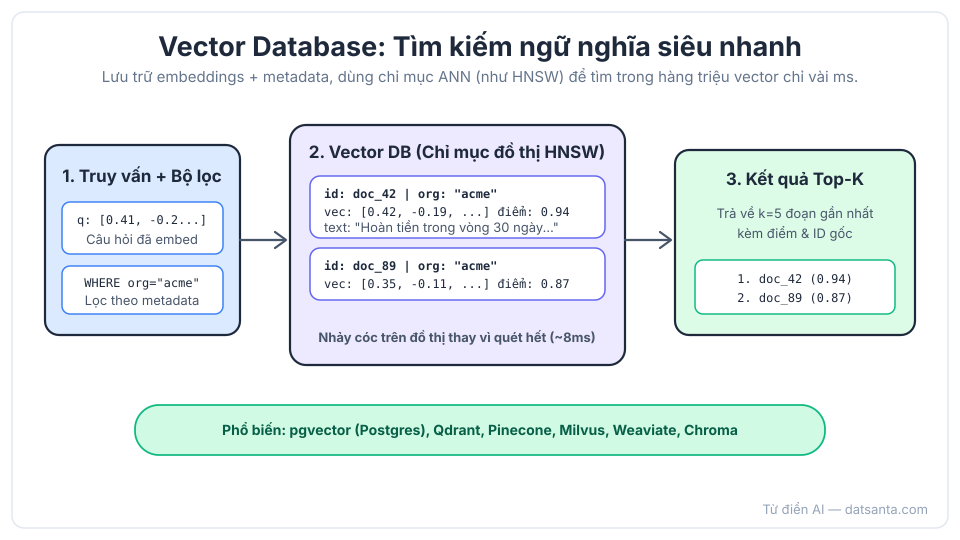

# Vector Database

**Vector database** lưu trữ các [embeddings](embeddings.md) kèm văn bản gốc và metadata, sử dụng các chỉ mục chuyên dụng (như `HNSW`) để tìm ra những đoạn giống nhau nhất về ngữ nghĩa trong hàng triệu bản ghi chỉ sau vài mili-giây.

## Ví dụ thực tế

Hãy tưởng tượng một thư viện sắp sách lên kệ 3D theo chủ đề thay vì xếp theo chữ cái A–Z. Thay vì đi bộ qua từng cuốn sách để dò (quét toàn bộ rất chậm), chỉ mục đồ thị `HNSW` giống như thang máy tốc hành nhảy thẳng tới đúng khu vực cần tìm.

Khi ứng dụng [RAG](rag.md) tìm `"chính sách hoàn tiền"`, vector database lọc `WHERE org = "acme"` và trả về 5 đoạn sát nghĩa nhất trong ~8ms.

## Đừng nhầm với

- **Tìm kiếm SQL `LIKE`:** SQL chỉ khớp chính xác ký tự (`%hoàn tiền%`), bỏ sót cụm `"đổi trả hàng"`; vector database tìm theo độ gần ngữ nghĩa qua [cosine similarity](cosine-similarity.md).
- **[Hybrid search](hybrid-search.md):** Vector database thuần dễ bỏ sót mã sản phẩm hay mã lỗi đặc thù, nên hệ thống thực tế thường ghép thêm tìm kiếm từ khóa (`BM25`).

## Thuật ngữ liên quan

- [Embeddings](embeddings.md)
- [Cosine Similarity](cosine-similarity.md)
- [RAG](rag.md)
- [Hybrid Search](hybrid-search.md)
