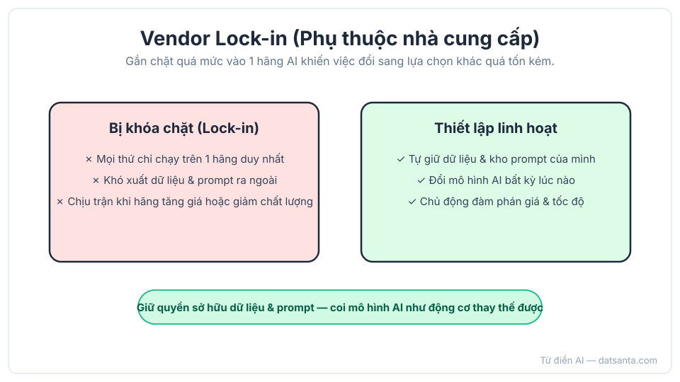

# Vendor Lock-in (Phụ thuộc nhà cung cấp)

**Vendor lock-in** xảy ra khi doanh nghiệp gắn dữ liệu, quy trình và thói quen đội ngũ quá chặt vào một nhà cung cấp AI duy nhất, đến mức việc chuyển sang giải pháp tốt hơn hoặc rẻ hơn trở nên quá tốn kém.

## Ví dụ đời thường

Hãy nghĩ đến việc mua máy pha cà phê chỉ dùng được viên nén độc quyền của một hãng. Lúc đầu máy rất rẻ, nhưng khi cả văn phòng đã quen dùng, bạn buộc phải chấp nhận mọi mức giá viên nén mà hãng đó đưa ra.

Trong AI, nếu bạn nhốt toàn bộ kho tri thức công ty vào một nền tảng khép kín không cho xuất dữ liệu sạch, bạn sẽ rất khó chuyển nhà khi đối thủ ra mức giá rẻ bằng nửa hoặc chất lượng tốt gấp đôi.

## Đừng nhầm với

- **[Build vs. Buy](build-vs-buy.md):** Mua công cụ có sẵn thường rất thông minh; lock-in chỉ thành vấn đề khi bạn không thể xuất dữ liệu, prompt hay quy trình ra ngoài về sau.
- **[Fine-tuning](fine-tuning.md):** Mô hình đã fine-tune trên nền tảng của một hãng thường khó mang sang hãng khác, khác với kho tài liệu độc lập dùng trong [RAG](rag.md).

## Thuật ngữ liên quan

- [Build vs. Buy](build-vs-buy.md)
- [RAG](rag.md)
- [AI ROI](ai-roi.md)
