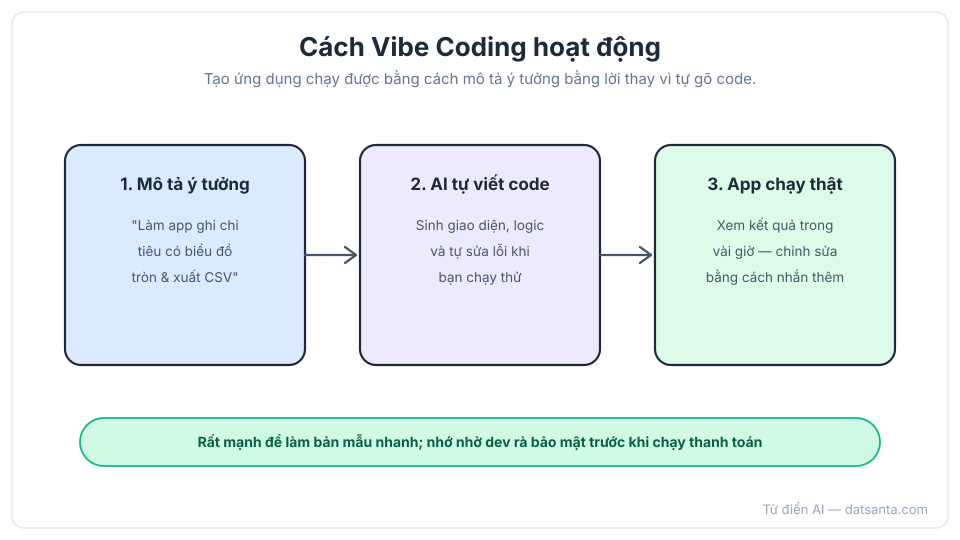

# Vibe Coding

**Vibe coding** là cách tạo ra website, script hoặc ứng dụng nhỏ bằng việc mô tả điều bạn muốn cho AI bằng ngôn ngữ tự nhiên rồi để AI tự viết và sửa code — thay vì bạn tự gõ từng dòng lệnh.

## Ví dụ thực tế

Hãy nghĩ tới việc chỉ đạo kiến trúc sư nội thất thay vì tự tay xây gạch. Bạn gõ *"Tạo giúp trang quản lý chi tiêu cá nhân có biểu đồ tròn và nút xuất file CSV"*, mở bản xem thử rồi dặn tiếp *"Làm nút to hơn và sửa lỗi cộng nhầm tổng"* đến khi ưng ý.

Vibe coding giúp người mới, designer và founder dựng bản mẫu trong vài giờ. Tuy nhiên với sản phẩm thật xử lý thanh toán hay dữ liệu người dùng, lập trình viên vẫn cần rà soát bảo mật và kiến trúc.

## Đừng nhầm với

- **Kỹ thuật phần mềm (Software engineering):** Làm phần mềm chuyên nghiệp đòi hỏi bảo mật, tối ưu tải, kiểm thử và bảo trì dài hạn; vibe coding ưu tiên tốc độ dựng thử nghiệm.
- **Công cụ No-code:** Công cụ kéo-thả ghép các khối dựng sẵn bị giới hạn; vibe coding sinh ra mã nguồn thật tùy biến qua [LLM](llm.md).

## Thuật ngữ liên quan

- [Copilot](copilot.md)
- [Prompt Engineering](prompt-engineering.md)
- [AI Agent](ai-agent.md)
- [Sandbox](sandbox.md)
