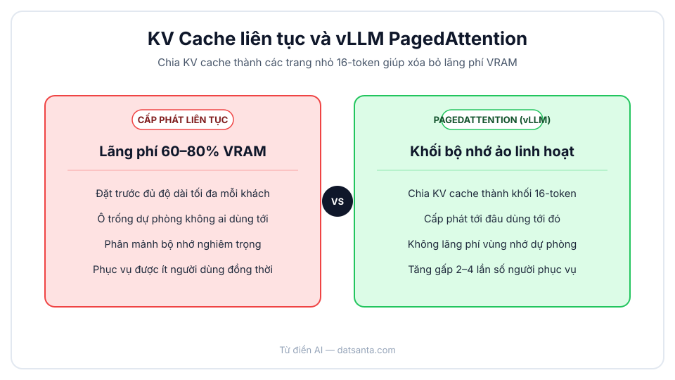

# vLLM (PagedAttention)

**vLLM** là bộ máy chạy suy luận (inference engine) mã nguồn mở thông lượng cao, nổi tiếng với kỹ thuật **PagedAttention** giúp quản lý bộ nhớ [KV cache](kv-cache.md) theo các khối nhỏ rời rạc—giống hệt cơ chế bộ nhớ ảo của hệ điều hành.

## Ví dụ thực tế

Các bộ máy phục vụ truyền thống thường đặt trước một làn đỗ xe dài liên tục bằng đúng độ dài tối đa cho mỗi yêu cầu, gây lãng phí 60–80% [VRAM](vram.md) vào các ô trống chờ sẵn. vLLM chia bộ nhớ GPU thành các khối nhỏ 16-token và cấp phát linh hoạt bất cứ chỗ nào còn trống—triệt tiêu phân mảnh bộ nhớ và phục vụ được nhiều người dùng đồng thời hơn hẳn trên cùng một GPU.

## Đừng nhầm với

- **[Ollama](ollama.md):** Ollama gói gọn `llama.cpp` để chạy thử một người trên laptop cực dễ; vLLM là inference engine GPU cho môi trường production chịu tải cao kèm [continuous batching](continuous-batching.md).

## Thuật ngữ liên quan

- [KV Cache](kv-cache.md)
- [Continuous Batching](continuous-batching.md)
- [VRAM](vram.md)
