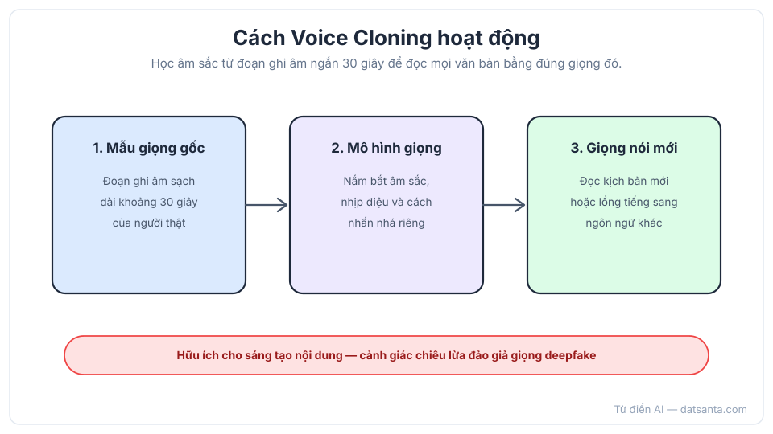

# Voice Cloning (Nhân bản giọng nói)

**Voice cloning** là kỹ thuật AI phân tích một đoạn ghi âm ngắn giọng nói của người thật rồi học cách đọc bất kỳ văn bản mới nào với đúng âm sắc, ngữ điệu và nhịp điệu của người đó.

## Ví dụ thực tế

Một diễn viên lồng tiếng chỉ cần thu mẫu 30 giây giọng đọc, sau đó phần mềm có thể đọc cả cuốn sách nói dài 10 tiếng hoặc dịch video YouTube của họ sang tiếng Tây Ban Nha mà vẫn giữ nguyên giọng gốc quen thuộc.

Dù rất hữu ích cho nhà sáng tạo nội dung và người mất giọng nói do bệnh lý, voice cloning cũng hay bị kẻ xấu lợi dụng để giả giọng người thân hoặc sếp trong các cuộc gọi lừa đảo [deepfake](deepfake.md).

## Đừng nhầm với

- **[Text-to-speech](text-to-speech.md) thông thường:** TTS chuẩn dùng giọng phòng thu có sẵn của hệ thống; voice cloning sao chép giọng của *một người thật cụ thể*.
- **Bộ đổi giọng (Voice changer):** Bộ lọc chỉnh cao độ chỉ bóp méo giọng bạn đang nói trực tiếp; voice cloning tự tổng hợp lời nói mới từ chữ viết.

## Thuật ngữ liên quan

- [Text-to-Speech](text-to-speech.md)
- [Deepfake](deepfake.md)
- [AI Watermark](ai-watermark.md)
- [Responsible AI](responsible-ai.md)
