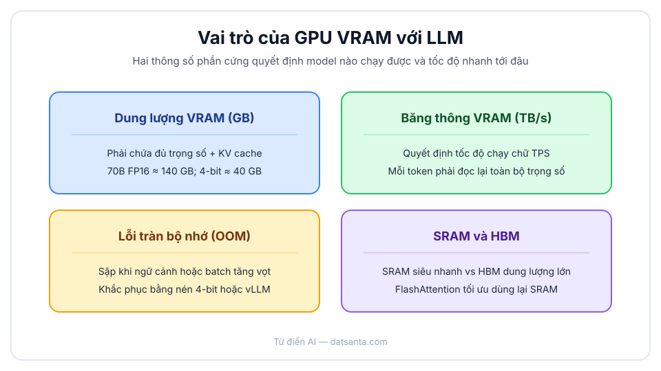

# VRAM (Bộ nhớ GPU)

**VRAM (Video RAM)** là bộ nhớ chuyên dụng siêu nhanh được hàn sát ngay cạnh các nhân tính toán của GPU—nơi chứa trọng số model, bộ nhớ đệm [KV cache](kv-cache.md) và các giá trị kích hoạt trong lúc huấn luyện hoặc chạy inference.

## Ví dụ thực tế

RAM hệ thống trên bo mạch chủ giống như kho hàng lớn ở cuối phố, còn VRAM là chiếc bàn làm việc tốc độ cao ngay trước mặt người thợ. Với LLM, có hai con số sống còn: **dung lượng VRAM** (tính bằng GB, quyết định có nạp nổi model 70B mà không bị lỗi tràn bộ nhớ OOM hay không) và **băng thông VRAM** (tính bằng TB/s, quyết định tốc độ chạy chữ TPS nhanh hay chậm).

## Đừng nhầm với

- **[Token](token.md):** Token là đơn vị văn bản model đọc và viết; VRAM là phần cứng bộ nhớ vật lý trên GPU dùng để chứa model và KV cache lúc chạy.

## Thuật ngữ liên quan

- [Quantization](quantization.md)
- [KV Cache](kv-cache.md)
- [Tensor Parallelism](tensor-parallelism.md)
