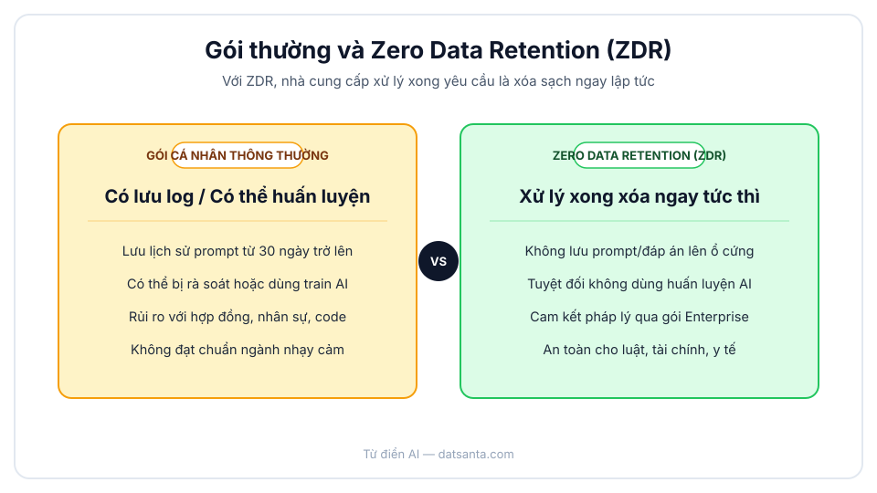

# Zero Data Retention (Không lưu giữ dữ liệu)

**Zero data retention (ZDR)** là cam kết pháp lý và kỹ thuật từ nhà cung cấp AI rằng prompt, tệp tải lên và câu trả lời của bạn sẽ bị xóa ngay lập tức sau khi xử lý—không lưu lại và không dùng để huấn luyện model tương lai.

## Ví dụ thực tế

Dùng công cụ AI công cộng không có ZDR giống như mang hợp đồng mật ra tiệm photocopy và tiệm đó giữ lại một bản nháp trên kệ để làm mẫu trình bày. Khi bật ZDR trên gói API doanh nghiệp, nhà cung cấp xử lý yêu cầu trên bộ nhớ tạm, trả kết quả về rồi hủy ngay dấu vết tạm thời đó—điều kiện bắt buộc với ngành luật, y tế và tài chính.

## Đừng nhầm với

- **[Data Residency](data-residency.md):** Data residency giữ dữ liệu nằm trong quốc gia được chọn; zero data retention đảm bảo nhà cung cấp không lưu giữ dữ liệu của bạn chút nào.

## Thuật ngữ liên quan

- [PII](pii.md)
- [IP Risk](ip-risk.md)
- [Enterprise Agreement](enterprise-agreement.md)
