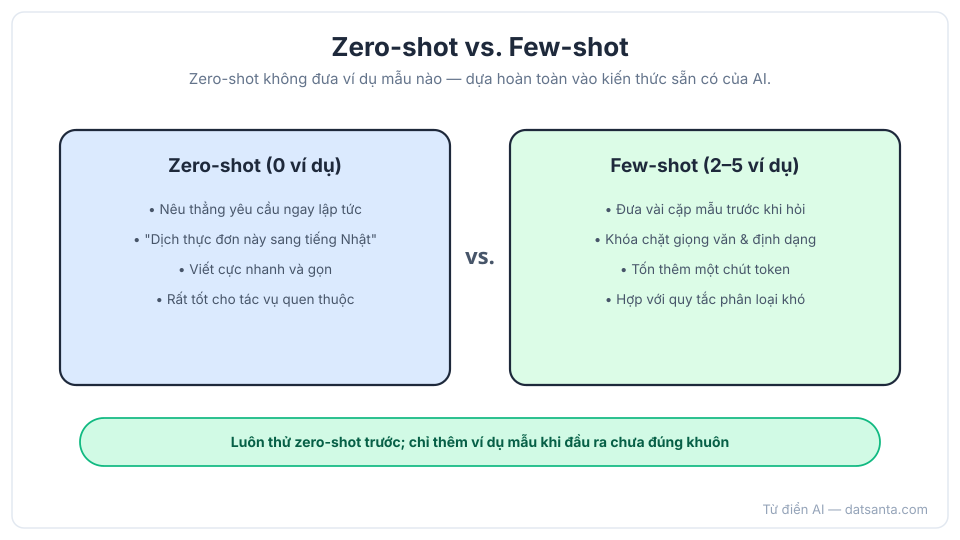

# Zero-shot

**Zero-shot** là cách yêu cầu AI làm một việc ngay lập tức chỉ bằng câu lệnh trực tiếp — mà không đưa cho nó bất kỳ ví dụ mẫu nào trước đó.

## Ví dụ thực tế

Nhờ đồng nghiệp *"Dịch giúp mình thực đơn này sang tiếng Nhật"* mà không đưa bản dịch mẫu nào chính là yêu cầu zero-shot. Họ dựa hoàn toàn vào kiến thức sẵn có của mình.

Các mô hình AI hiện đại làm rất tốt các việc zero-shot như tóm tắt bài báo, dịch email hay giải thích khái niệm. Khi công việc đòi hỏi định dạng riêng chặt chẽ hoặc giọng điệu khó, việc thêm 2–3 ví dụ ([few-shot prompting](few-shot-prompting.md)) thường cho kết quả ổn định hơn.

## Đừng nhầm với

- **[Few-shot prompting](few-shot-prompting.md):** Few-shot kèm sẵn 2–5 cặp ví dụ mẫu ngay trong prompt; zero-shot không kèm ví dụ nào.
- **Không biết gì:** "Zero-shot" chỉ có nghĩa là *bạn* không đưa ví dụ trong prompt — AI vẫn sử dụng toàn bộ kiến thức nó đã học lúc huấn luyện.

## Thuật ngữ liên quan

- [Few-shot Prompting](few-shot-prompting.md)
- [Prompt](prompt.md)
- [Prompt Engineering](prompt-engineering.md)
